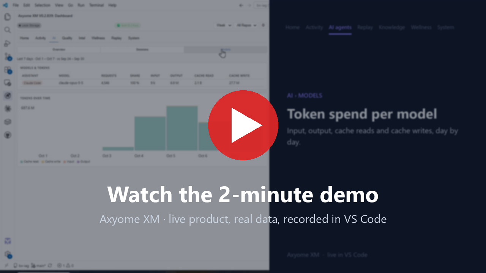
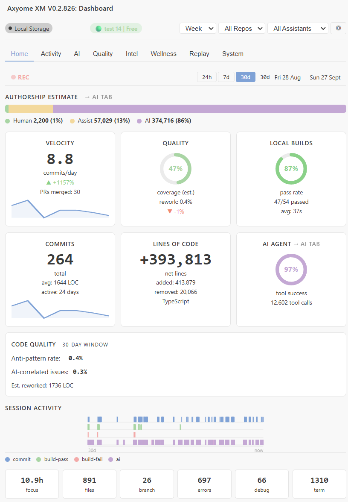

<div align="center">
  <h1>Axyome XM</h1>
  <p><strong>Your AI forgets. Axyome XM remembers.</strong></p>
  <p>The black box flight recorder for AI-assisted coding.</p>

  
  
  
  
</div>

---

## What is Axyome XM?

- **Remembers.** The files you edited, the errors you hit, the terminal commands you ran, your commits, and your Copilot and Claude Code sessions. Search it by keyword, or replay any past coding day in Time Machine.
- **Local.** Your activity is recorded and stored on your own machine. No third-party analytics. See [Privacy](#privacy).
- **Works with Copilot and Claude Code.** Copilot recalls your history through the Axyome XM MCP server, which the extension registers in VS Code. Claude Code and other MCP clients can connect to the same server.

---

## Demo

<a href="https://www.youtube.com/watch?v=XEoMJM7y6J8">
  
</a>

▶ **[Watch the 2.5-minute product demo](https://www.youtube.com/watch?v=XEoMJM7y6J8)**: live product, real data, recorded in VS Code.

> *"What was that async error I fixed last week?"*

Within seconds, your AI assistant retrieves the exact file, error message, and the fix you applied - without you searching through logs or git blame.

-> [Full demo walkthrough](docs/demo.md)

---

## Key Features

| Feature | What it does |
|---------|-------------|
| **Persistent Memory** | Captures files, errors, commands, and commits across every session |
| **Keyword Search** | FTS5 keyword search over activity, decisions and chat history, ranked by match and recency |
| **XM Wiki** | Auto-generates a searchable knowledge base from your sessions |
| **Session Analytics** | ATI score, productivity heatmap, tool usage breakdown |
| **Achievement System** | 12 badges: Prompt Master, Flow State, Week Streak, and more |
| **54 MCP Tools** | Full `axm_*` tool suite - ask AI to search, recall, and log for you |
| **Time Machine** | Replay any past coding day chapter by chapter |
| **Copilot + Claude Code** | Dashboard compares both assistants side by side |
| **Local-first** | Your data stays on your machine. Nothing is sent anywhere unless you sign in — see [Privacy](#privacy). |

---

## Install

Axyome XM is **not listed on the VS Code Marketplace** or Open VSX yet at the time of writing
(checked 2026-10-18). Install the VSIX for your platform:

```bash
code --install-extension axyome-xm-win32-x64-<version>.vsix --force
```

-> [Detailed install guide with platform notes](docs/install.md)

---

## Quick Start

After installing, Axyome XM activates automatically:

1. **Choose what is recorded.** A panel lists every source with what it stores; nothing is
   recorded until you press **Start recording** ("Recommended" turns them all on).
2. **Follow "Get started with Axyome XM"** (VS Code's Welcome page, or **Welcome: Open
   Walkthrough...**): it checks that Copilot can reach the Axyome XM MCP server and imports your
   own commits of the last 90 days, so memory has something to recall on day one.
3. **Ask Copilot** in Agent mode: **"What did I work on this week?"** The walkthrough's last step
   opens the chat with the question filled in.
4. Open the Dashboard from the **Axyome XM** icon in the Activity Bar (or `Ctrl+Shift+Alt+M`).
   **Axyome: Start Onboarding** offers a quick or full tour of the features.

-> [Complete onboarding guide](docs/onboarding.md)

---

## Dashboard



8 tabs: Home, Activity, AI, Quality, Intel, Wellness, Replay and System.

-> [Dashboard tour with screenshots of every tab](docs/dashboard.md)

---

## Requirements

| Requirement | Minimum |
|-------------|---------|
| VS Code | 1.139.0+ |
| GitHub Copilot | Any (for MCP tool use) |
| Node.js | Not required - binary is embedded |

---

## Platform Support

| Platform | VSIX Size | Notes |
|----------|-----------|-------|
| Windows (win32-x64) | ~24 MB | Native better-sqlite3 |
| Linux (linux-x64) | ~29 MB | Native better-sqlite3 |
| macOS Intel (darwin-x64) | ~26 MB | Native better-sqlite3 |
| macOS Apple Silicon (darwin-arm64) | ~25 MB | Native better-sqlite3; ad-hoc signed MCP server |

Sizes measured on the 0.2.867 build.

---

## MCP Tool Suite

Axyome XM ships with **54 MCP tools** (`axm_*`) served by an embedded MCP
server, so GitHub Copilot can use them without manual setup.

**Tool diet.** To keep every request small, the server lists 11 core tools by
default (recall, session summary, context snapshot, error forensics, similar
errors, decisions, observations, hybrid search, health and tool discovery). Set
`axyomeXM.mcp.toolset` to `all` to list all 54. Tools that are not listed still
run when called by name, and `axm_list_available_tools` names what is hidden.

**What it writes into your workspace.** Nothing without asking. The extension registers its MCP
server with VS Code, so Copilot lists **Axyome XM** without a `.vscode/mcp.json` in your
repository. It then offers to add `AGENTS.md`, `.github/agents/memory.md` and recommended VS Code
settings (Configure All / Choose... / Skip / Don't Ask Again); skipping or dismissing the prompt
writes nothing. **Axyome XM: Configure Workspace for AI Memory** runs the same setup later.

```
axm_recall_activity        - Search past work by query, file, or date
axm_search_sessions        - Keyword search through chat history
axm_get_session_summary    - Summarize what you worked on
axm_log_decision           - Remember a decision or preference
axm_find_similar_errors    - Check if you've seen this bug before
axm_wiki_query             - Search your personal knowledge wiki
axm_get_developer_intelligence - Full DIP score and recommendations
... and 47 more
```

-> [Full MCP tool reference](docs/mcp-tools-reference.md)

---

## Plans

| Plan | Price | History you can see |
|---|---|---|
| Free | $0 | The last 30 days |
| Pro | $9/month | All of it |
| Team & Enterprise | [Contact sales](https://app.axyome.ai/pricing#contact-sales) | All of it, plus cloud sync across devices |

Every feature works on every plan, and a plan never deletes your data — it only changes how much
history you can see. Axyome XM runs as a 30-day preview first; after that, a free account is
needed to keep using it. Details: [app.axyome.ai/pricing](https://app.axyome.ai/pricing).

---

## Privacy

- All data stored locally at `%APPDATA%\Code\User\globalStorage\axyome.axyome-xm\`
- Without an account, Axyome XM makes no network requests.
- After you sign in, it contacts `api.axyome.ai` to confirm your plan (about every 4 hours) and to
  register this device (its name and platform). No third-party analytics. Cloud sync only on Team & Enterprise plans.
- **Nothing is recorded until you choose.** On first run a panel lists every source (Claude Code,
  Copilot chat and agent edits, files, git, terminal, editor, selections, problems, debug, tasks,
  coding time) with what it stores; "Recommended" turns them all on, and each has its own toggle.
  Change it any time with **Axyome XM: Review Capture Settings**.
- With Git on, a new install also reads your own commits of the last 90 days once (hash, message,
  time, branch, per-file line counts), so recall works on day one. Set `axyomeXM.history.gitDays`
  to `0` to skip it; **Axyome XM: Import Git History** runs it on demand.
- Terminal commands and editor selections are stored with secrets redacted
- Take your data with you: **Axyome XM: Export All My Data** writes every table to JSON and Markdown in a folder you choose
- Remove it all, anytime: **Axyome XM: Delete All My Data** (type `DELETE` to confirm) deletes the database contents, backups and
  queued events on this computer. Uninstalling the extension alone does not remove them; the [uninstall and data removal guide](docs/uninstall.md) lists what is stored and where

-> [Full privacy policy](docs/privacy.md)

---

## Documentation

| Doc | Description |
|-----|-------------|
| [Install](docs/install.md) | Installation, platform notes, troubleshooting |
| [Onboarding](docs/onboarding.md) | Your first 10 minutes |
| [Dashboard Tour](docs/dashboard.md) | Every tab, with screenshots |
| [MCP Tools Reference](docs/mcp-tools-reference.md) | All 54 `axm_*` tools |
| [Tips & Tricks](docs/tips.md) | Power-user workflows |
| [FAQ](docs/faq.md) | Common questions answered |
| [Privacy](docs/privacy.md) | What is (and isn't) collected |
| [Uninstall and data removal](docs/uninstall.md) | Export, delete everything, uninstall |
| [Demo Scenarios](docs/demo.md) | Concrete use cases |
| [Changelog](CHANGELOG.md) | Release history |

---

## Support

- [Bug Reports](https://github.com/axyome-ai/axyome-xm/issues/new?template=bug_report.yml)
- [Feature Requests](https://github.com/axyome-ai/axyome-xm/issues/new?template=feature_request.yml)
- [Questions](https://github.com/axyome-ai/axyome-xm/issues/new?template=question.yml)
- [Website](https://axyome.ai)

---

## License

Proprietary (c) [Axyome](https://axyome.ai) - All rights reserved.  
See [LICENSE](LICENSE) for details. Third-party components and their licences are listed in
`THIRD-PARTY-NOTICES.txt`, shipped with the extension.
