# Dashboard Tour

The dashboard opens from the **Axyome XM** icon in the Activity Bar, from the
Command Palette (**Axyome XM: Show Dashboard**), or with `Ctrl+Shift+Alt+M`
(`Cmd+Shift+Alt+M` on macOS).

It has 8 tabs. The header filters (time scope, repository) apply to every tab.
Most tabs cover both GitHub Copilot and Claude Code. Codex sessions appear too:
in Activity › Unified, in AI › Sessions and Models, and in System › Sources.

| Tab | Sub-tabs |
|-----|----------|
| **Home** | (single page) |
| **Activity** | Live, Coding, History, Heatmap, Unified |
| **AI** | Overview, Sessions, Models |
| **Quality** | Score, Errors, Files, Patterns |
| **Intel** | Score, Progress, Actions, Value, Knowledge |
| **Wellness** | Radar, Flow, Trends, Recommendations |
| **Replay** | Time Machine, Map, Wiki, Use |
| **System** | Overview, Queues, Tables, Sources, Badges, Account, Settings |

On a new install, Intel, Wellness and some sub-tabs (for example Heatmap,
Patterns, Wiki and Badges) are hidden. Tick them in **System › Settings** to
show them.

Screenshots below were captured from Axyome XM 1.2.10 on 2026-11-25 with real
activity data. The title bar shows the running version (VS Code capitalises
view titles, so it reads "V1.2.10"). Lists of file paths and project names are
blurred.

---

## Home

Today's work, the authorship estimate (human / assisted / AI), commits, lines
of code, velocity and AI agent tool success, then focus time, files edited,
branches, editor errors, debug sessions and commands.

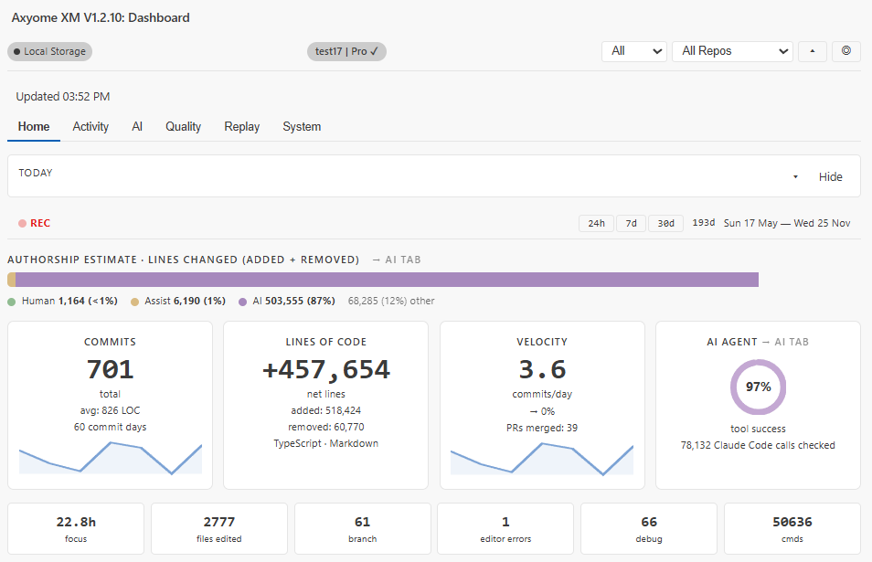

---

## Activity

Coding time, daily average, active days and files, coding time per week,
languages, projects and the files you spent most time in. The other sub-tabs
show a live feed, history, a heatmap and a unified timeline of your actions and
your assistants'.

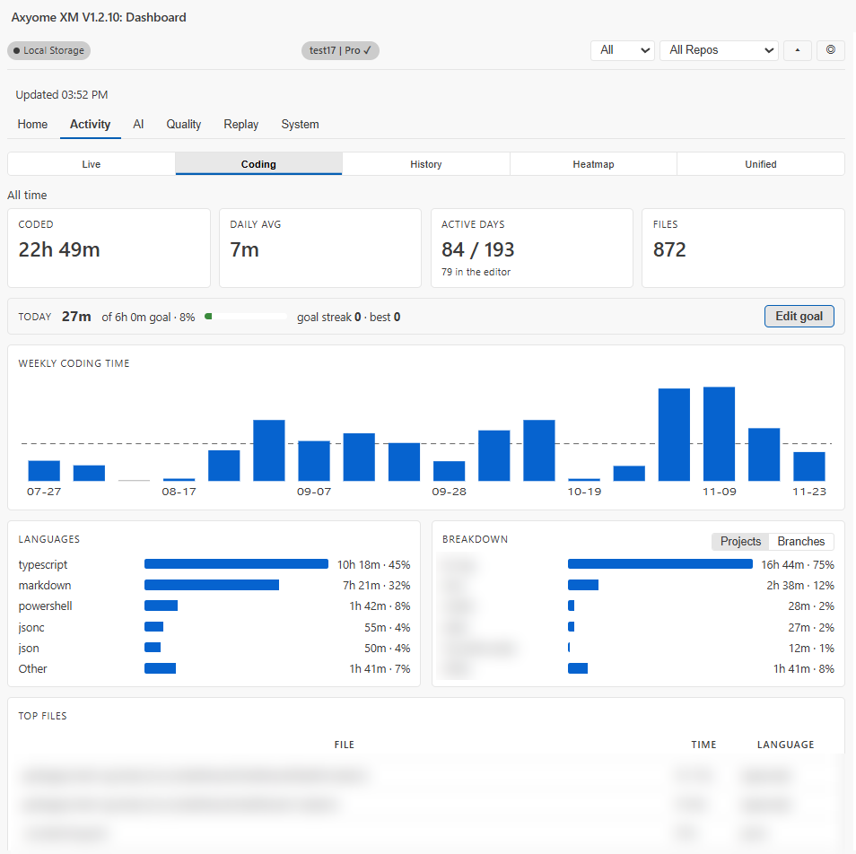

---

## AI

What AI work delivered and what it cost: commits shipped, fix-commit share,
output tokens per commit, prompt-to-commit time, agent tool failures, cache-hit
ratio, active AI days, failed commands and tokens used, each with its trend.
**Sessions** lists every Claude Code, Copilot and Codex session; **Models**
shows tokens per model.

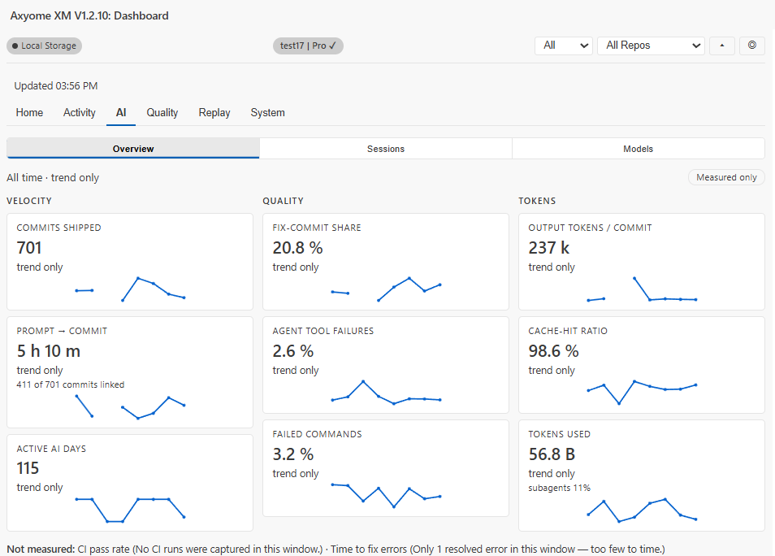

---

## Quality

Errors introduced and resolved, time to fix, fix-commit share, release commits,
lead time, failed commands and config notices, then coverage, local builds and
code quality indicators.

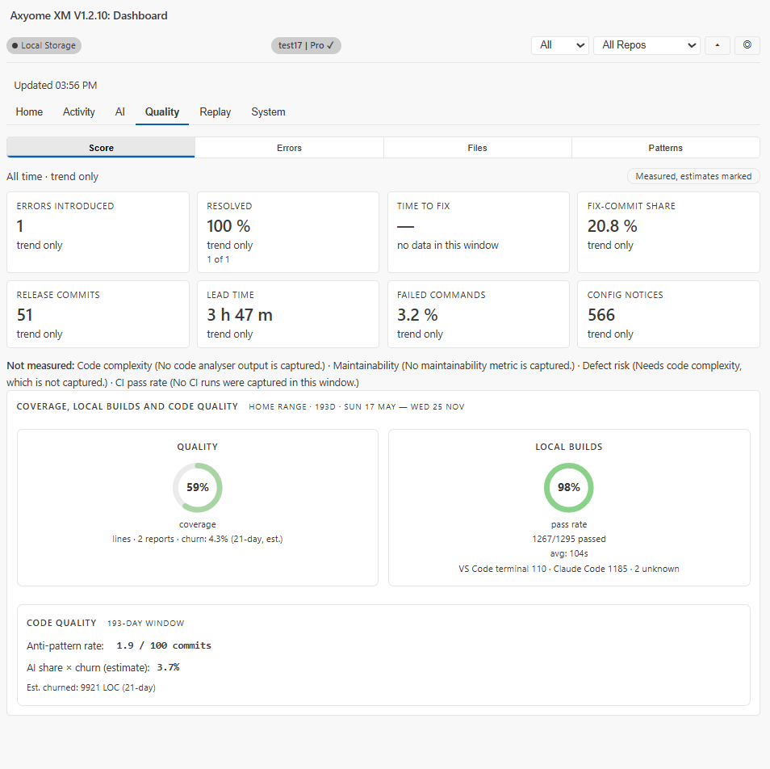

---

## Intel

The Developer Intelligence score, your level, and the four pillars: Velocity,
Reliability, Efficiency and Learning, each with its trend.

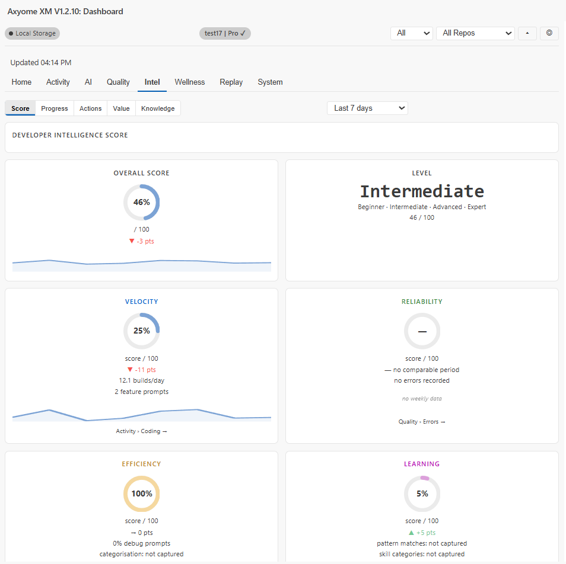

---

## Wellness

Wellness score, flow time, flow quality, cognitive load, work-boundary streak,
time outside working hours and the weighted cognitive dimensions behind the
score.

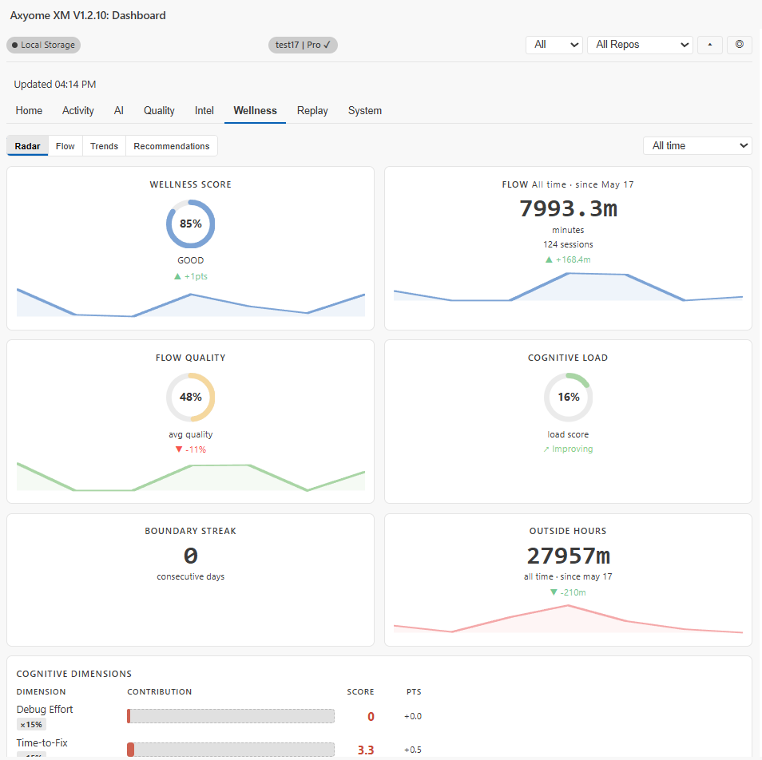

---

## Replay

### Time Machine

Pick a day (or week) and load it. The summary shows events, chapters, active
time and errors, compared with your 30-day average.

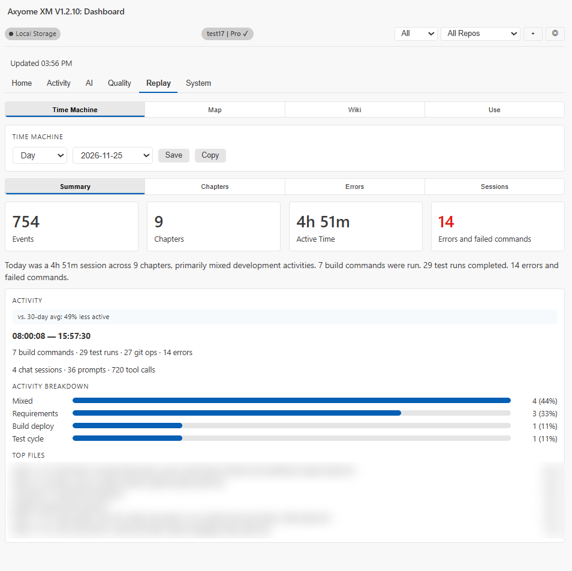

Chapters are detected automatically and colour-coded by activity type. Select a
chapter to see its files and the commands that ran.

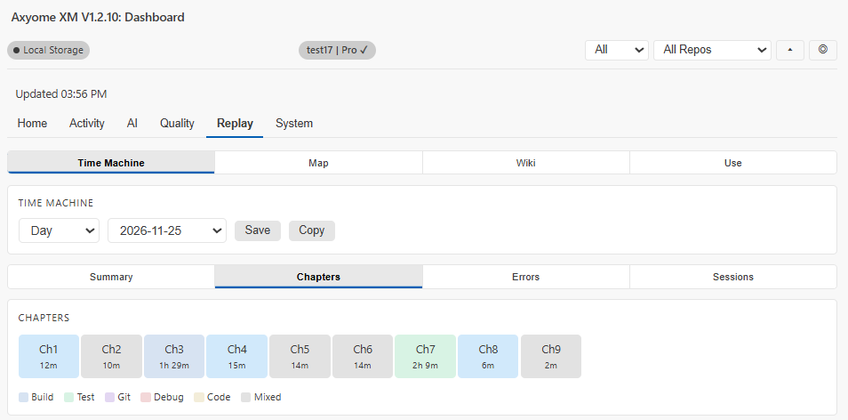

### Use

Items in memory, database size, tool calls, AI sessions, the ATI ratio, skills
and the most used tools of each assistant.

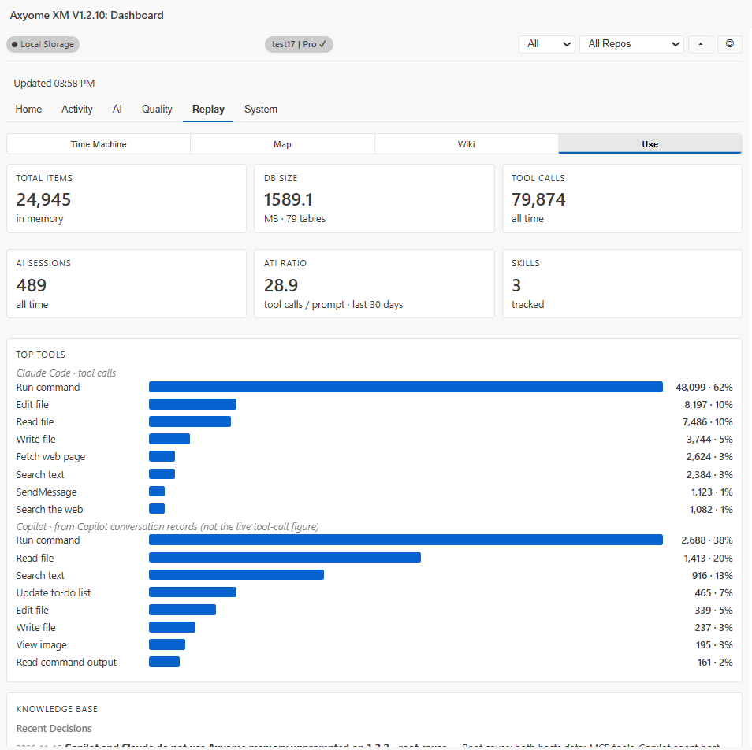

---

## System

### Overview

Events captured today, database size, queue depth, failed files and the top
event sources.

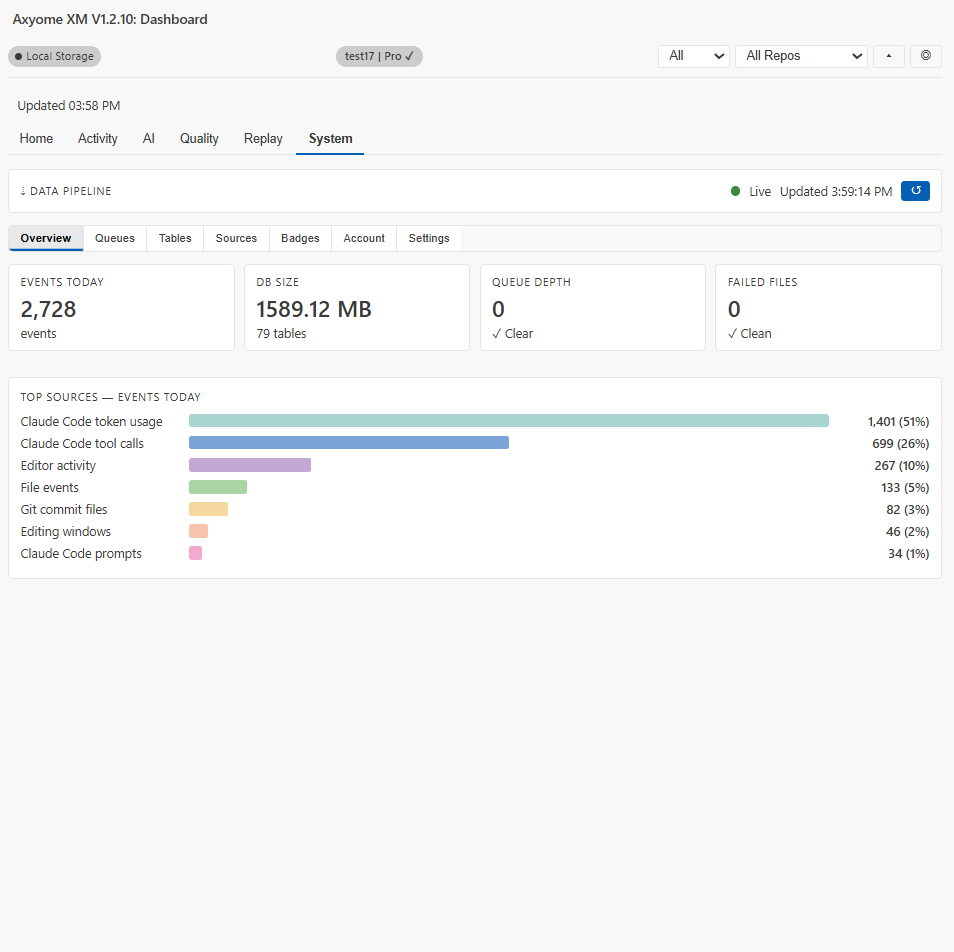

### Badges

The 10 achievement badges and when each was unlocked.

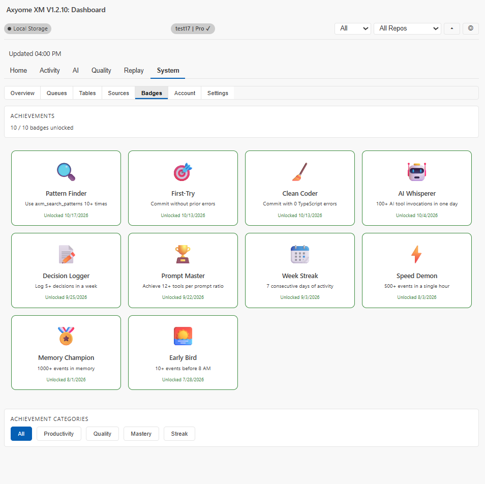
